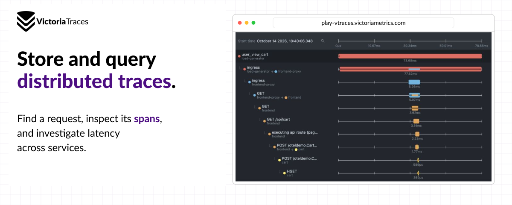

# VictoriaTraces

**Store and query distributed traces. Find a request, inspect its spans, and investigate latency across services.**

[Playground](https://play-vtraces.victoriametrics.com/select/vmui/) · [Quickstart](https://docs.victoriametrics.com/victoriatraces/quick-start/) · [Documentation](https://docs.victoriametrics.com/victoriatraces/) · [Releases](https://github.com/VictoriaMetrics/VictoriaTraces/releases)

<picture>
  <source media="(max-width: 640px)" srcset="banners/traces-split-mobile.png">
  
</picture>

> **Work in progress.** On-disk formats and APIs may change without backward compatibility; some links or static files may be unavailable. Read the [changelog](https://docs.victoriametrics.com/victoriatraces/changelog/) before upgrading.

VictoriaTraces is an open-source trace database in the VictoriaMetrics family, designed for low resource usage.

## Find a request

Open a trace in the [built-in UI](https://docs.victoriametrics.com/victoriatraces/querying/#web-ui), inspect its waterfall, then review the selected span’s fields, events and links.

## How traces move through VictoriaTraces

VictoriaTraces uses the VictoriaLogs storage engine internally: it transforms incoming OTLP spans into structured logs and exposes trace query APIs. You do not need to run a separate VictoriaLogs service.

| Feature | Support |
| --- | --- |
| OpenTelemetry ingestion | [OTLP/HTTP and OTLP/gRPC](https://docs.victoriametrics.com/victoriatraces/data-ingestion/opentelemetry/) from SDKs or Collectors; enable the gRPC listener separately. |
| Built-in trace UI and LogsQL | [Trace Explorer and TraceID](https://docs.victoriametrics.com/victoriatraces/querying/#web-ui) for inspecting requests; LogsQL for querying span data. |
| Jaeger Query Service JSON APIs | Connect [Jaeger UI or Grafana's Jaeger datasource](https://docs.victoriametrics.com/victoriatraces/querying/#jaeger-http-api). |
| Local storage | [Compressed spans on disk](https://docs.victoriametrics.com/victoriatraces/#storage), without an external database or object store. |
| Single-node and cluster deployments | One binary or [separate ingestion, query and storage roles](https://docs.victoriametrics.com/victoriatraces/cluster/). |
| Multitenancy | [AccountID and ProjectID headers](https://docs.victoriametrics.com/victoriatraces/#multitenancy) separate data; per-tenant authorization requires a proxy. |

## Deploy and operate

- **Kubernetes:** [Helm single-node](https://docs.victoriametrics.com/helm/victoria-traces-single/), [Helm cluster](https://docs.victoriametrics.com/helm/victoria-traces-cluster/), or [VictoriaMetrics Operator](https://docs.victoriametrics.com/operator/resources/).
- **Operate:** [Retention](https://docs.victoriametrics.com/victoriatraces/#retention), [monitoring](https://docs.victoriametrics.com/victoriatraces/#monitoring), [backup and restore](https://docs.victoriametrics.com/victoriatraces/#backup-and-restore), and [alerting](https://docs.victoriametrics.com/victoriatraces/vmalert/).
- **Protect access:** Put ingestion and query endpoints behind [vmauth or an authorization proxy](https://docs.victoriametrics.com/victoriatraces/#security).

Both deployment modes are open source under [Apache 2.0](https://github.com/VictoriaMetrics/VictoriaTraces/blob/master/LICENSE).

<details>
<summary>Optional: try locally with Docker</summary>

```sh
docker run --rm -it -p 127.0.0.1:10428:10428 -v ./victoria-traces-data:/victoria-traces-data \
  docker.io/victoriametrics/victoria-traces:latest
```

Run the [sample-span command](https://docs.victoriametrics.com/victoriatraces/quick-start/#write-data) with `<victoria-traces>` set to `localhost`. Allow for the [default 30-second search offset](https://docs.victoriametrics.com/victoriatraces/querying/#search-latency), then open [the local UI](http://localhost:10428/select/vmui/) and use TraceID `1af5dd013a30efe7f2970032ab81958b`. Data persists in `./victoria-traces-data`; the port is bound to localhost.

</details>

## Community and contributions

[Join Slack](https://slack.victoriametrics.com/) · [Report an issue](https://github.com/VictoriaMetrics/VictoriaTraces/issues) · [Contribution guide](https://docs.victoriametrics.com/victoriametrics/contributing/)

Related: [VictoriaMetrics](https://github.com/VictoriaMetrics/VictoriaMetrics) · [VictoriaLogs](https://github.com/VictoriaMetrics/VictoriaLogs).
