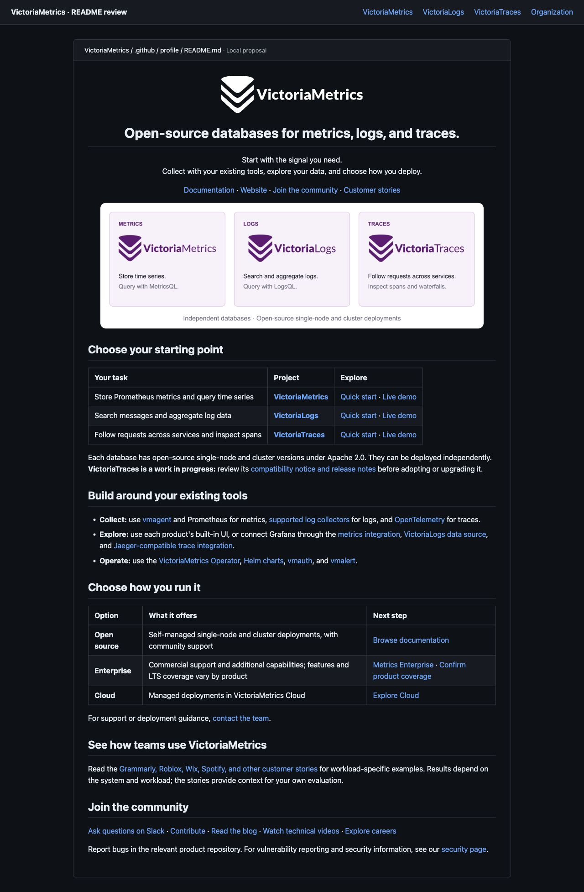

# VictoriaMetrics GitHub README refresh

Review proposals for VictoriaMetrics, VictoriaLogs, VictoriaTraces, and the organization profile. Updated October 30, 2026. Official upstream repositories are unchanged.

| Page | GitHub-rendered proposal | Full-page visual preview |
| --- | --- | --- |
| Metrics | [VictoriaMetrics README](VictoriaMetrics/README.md) | [Preview](previews/VictoriaMetrics.jpg) |
| Logs | [VictoriaLogs README](VictoriaLogs/README.md) | [Preview](previews/VictoriaLogs.jpg) |
| Traces | [VictoriaTraces README](VictoriaTraces/README.md) | [Preview](previews/VictoriaTraces.jpg) |
| Organization | [Organization profile](organization/profile/README.md) | [Preview](previews/Organization.jpg) |

[Audit and additional opportunities](AUDIT.md) · [Sources and image provenance](SOURCES.md) · [Validation](research/validation.md)

Each product folder includes a complete README, official light/dark logos, fresh playground screenshots, and an editable SVG diagram with a PNG export. The organization profile targets the existing `VictoriaMetrics/.github/profile/README.md`.

## Review the organization direction

## Deployment notes

Copy each product README and its assets directory to its corresponding repository. Copy `organization/profile` to the `.github` repository's `profile` directory. Check paths in GitHub before merging. This review does not change repository settings, pins, or topics.

The earlier Traces banner assets remain in `banners/`, and the prior proposal remains on the main branch.
