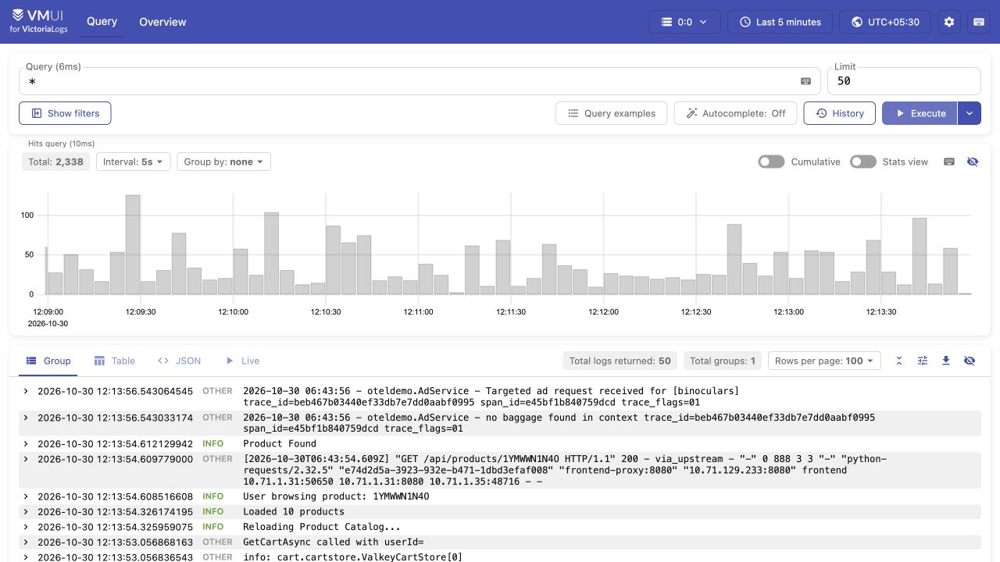
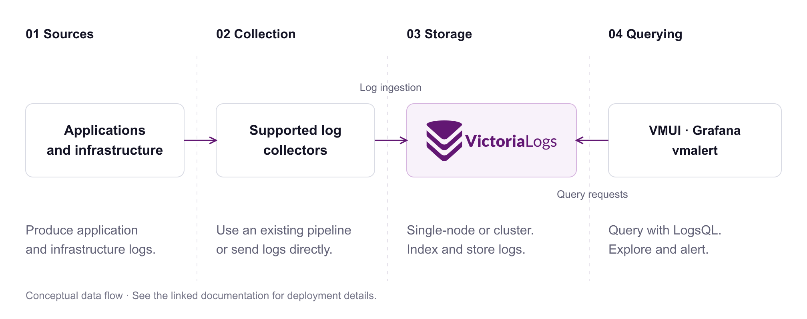

<p align="center">
  <picture><source media="(prefers-color-scheme: dark)" srcset="assets/logo-dark.svg"></picture>
</p>
<h1 align="center">Find the logs that explain what happened.</h1>
<p align="center">An open-source, schema-free log database.<br>Search, filter, and aggregate your logs with LogsQL.</p>

<p align="center"><a href="#try-it-locally">Quick start</a> · <a href="https://play-vmlogs.victoriametrics.com/">Live playground</a> · <a href="https://docs.victoriametrics.com/victorialogs/">Documentation</a> · <a href="https://slack.victoriametrics.com/">Community</a></p>
<p align="center">
  <a href="https://github.com/VictoriaMetrics/VictoriaLogs/releases"></a>
  <a href="https://github.com/VictoriaMetrics/VictoriaLogs/actions/workflows/main.yml"></a>
  <a href="https://github.com/VictoriaMetrics/VictoriaLogs/blob/master/LICENSE"></a>
</p>

<p align="center"><a href="https://play-vmlogs.victoriametrics.com/"></a></p>
<p align="center"><sub>See log volume over time and inspect the underlying messages. <a href="https://play-vmlogs.victoriametrics.com/">Try LogsQL live →</a></sub></p>

## Why VictoriaLogs?

- **Start querying without defining a schema.** Ingest structured and unstructured logs; VictoriaLogs creates the indexes needed for querying. [Data model](https://docs.victoriametrics.com/victorialogs/keyconcepts/).
- **Go from a message to an aggregate.** Search text, filter fields, and build statistics with [LogsQL](https://docs.victoriametrics.com/victorialogs/logsql/).
- **Keep your collection pipeline.** Send logs with supported collectors and protocols, including OpenTelemetry. [Ingestion options](https://docs.victoriametrics.com/victorialogs/data-ingestion/).
- **Choose a deployment that fits.** Run a single binary or a cluster with separate ingestion, query, and storage roles. Both are open source. [Cluster architecture](https://docs.victoriametrics.com/victorialogs/cluster/).

## Try it locally

With Docker installed, start VictoriaLogs:

```sh
docker run --rm --name victorialogs \
  -p 127.0.0.1:9428:9428 \
  -v victorialogs-data:/victoria-logs-data \
  victoriametrics/victoria-logs:v1.53.0 \
  -storageDataPath=/victoria-logs-data
```

In another terminal, send two example log messages:

```sh
printf '%s\n' \
  '{"_msg":"checkout completed","level":"info","service":"checkout"}' \
  '{"_msg":"payment timed out","level":"error","service":"checkout"}' |
curl -X POST -H 'Content-Type: application/stream+json' \
  --data-binary @- 'http://localhost:9428/insert/jsonline?_stream_fields=service'
```

Open [VMUI](http://localhost:9428/select/vmui/) and run `level:error`. You should see the payment timeout message. Logs without timestamps receive the ingestion time. Data persists in the named Docker volume. [Full quick start](https://docs.victoriametrics.com/victorialogs/quickstart/).

## How it works

<p align="center"><a href="assets/how-it-works.svg"></a></p>

Run the ingestion, storage, and query functions in one binary, or scale them separately as **vlinsert**, **vlstorage**, and **vlselect**. [Architecture details](https://docs.victoriametrics.com/victorialogs/cluster/).

## Explore your logs

| I want to… | Example or guide |
| --- | --- |
| Find error messages | `level:error` on the sample data above |
| Count logs per service | `* \| stats by (service) count()` on the sample data |
| Build dashboards | [Grafana integration](https://docs.victoriametrics.com/victorialogs/victorialogs-datasource/) |
| Learn LogsQL from another language | [SQL to LogsQL](https://play-sql.victoriametrics.com/) · [LogQL to LogsQL](https://play-logql.victoriametrics.com/) |
| Alert on log patterns | [vmalert for VictoriaLogs](https://docs.victoriametrics.com/victorialogs/vmalert/) |

## Deploy and operate

| Task | Documentation |
| --- | --- |
| Install | [Binaries](https://github.com/VictoriaMetrics/VictoriaLogs/releases/latest) · [Docker](https://hub.docker.com/r/victoriametrics/victoria-logs/) · [Helm charts](https://docs.victoriametrics.com/helm/) |
| Choose a topology | [Single-node](https://docs.victoriametrics.com/victorialogs/) · [Cluster](https://docs.victoriametrics.com/victorialogs/cluster/) |
| Manage data and access | [Retention](https://docs.victoriametrics.com/victorialogs/#retention) · [Security](https://docs.victoriametrics.com/victorialogs/#security) · [Multitenancy](https://docs.victoriametrics.com/victorialogs/#multitenancy) |
| Monitor and upgrade | [Monitoring](https://docs.victoriametrics.com/victorialogs/#monitoring) · [Upgrade guide](https://docs.victoriametrics.com/victorialogs/#upgrading) · [Changelog](https://docs.victoriametrics.com/victorialogs/changelog/) |

For a managed deployment, explore [VictoriaMetrics Cloud](https://victoriametrics.com/products/cloud/). For commercial support and product-specific availability, [contact the VictoriaMetrics team](mailto:info@victoriametrics.com).

## Community and contributions

[Join Slack](https://slack.victoriametrics.com/) · [Report an issue](https://github.com/VictoriaMetrics/VictoriaLogs/issues) · [Contribute](https://docs.victoriametrics.com/victoriametrics/contributing/) · [Apache 2.0 license](https://github.com/VictoriaMetrics/VictoriaLogs/blob/master/LICENSE) · [Careers](https://careers.victoriametrics.com/)

Looking for another signal? [VictoriaMetrics — metrics](https://github.com/VictoriaMetrics/VictoriaMetrics) · [VictoriaTraces — traces](https://github.com/VictoriaMetrics/VictoriaTraces).
