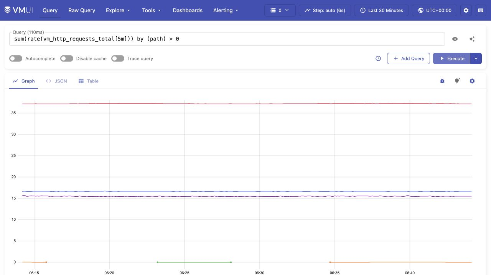
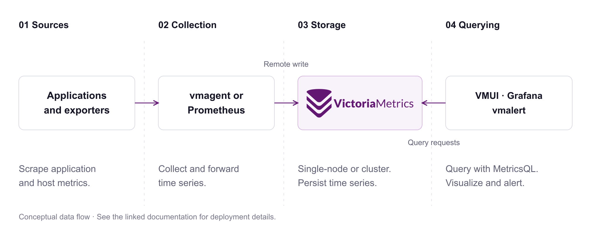

<p align="center">
  <picture><source media="(prefers-color-scheme: dark)" srcset="assets/logo-dark.svg"></picture>
</p>
<h1 align="center">Keep your metrics. Scale your monitoring.</h1>
<p align="center">An open-source time series database for Prometheus metrics and beyond.<br>Collect, store, and query metrics with a single binary or a cluster.</p>

<p align="center">
  <a href="#try-it-locally">Quick start</a> · <a href="https://play.victoriametrics.com/">Live playground</a> · <a href="https://docs.victoriametrics.com/victoriametrics/">Documentation</a> · <a href="https://slack.victoriametrics.com/">Community</a>
</p>
<p align="center">
  <a href="https://github.com/VictoriaMetrics/VictoriaMetrics/releases"></a>
  <a href="https://github.com/VictoriaMetrics/VictoriaMetrics/actions/workflows/build.yml"></a>
  <a href="https://github.com/VictoriaMetrics/VictoriaMetrics/blob/master/LICENSE"></a>
</p>

<p align="center"><a href="https://play.victoriametrics.com/"></a></p>
<p align="center"><sub>Query and graph metrics in the built-in VMUI. <a href="https://play.victoriametrics.com/">Explore the live playground →</a></sub></p>

## Why VictoriaMetrics?

- **Keep your Prometheus workflow.** Use Prometheus remote write, PromQL-compatible queries, and your existing Grafana dashboards. [Prometheus integration](https://docs.victoriametrics.com/victoriametrics/integrations/prometheus/).
- **Start with fewer moving parts.** The single-node database runs as one binary without an external database. Move to independently scalable ingestion, query, and storage components when you need a cluster. [Deployment options](https://docs.victoriametrics.com/victoriametrics/cluster-victoriametrics/).
- **Query across your metric sources.** Collect from multiple Prometheus servers or supported ingestion protocols and query the data together with [MetricsQL](https://docs.victoriametrics.com/victoriametrics/metricsql/).
- **Evaluate with evidence.** Read how [Grammarly, Roblox, Wix, and other teams](https://docs.victoriametrics.com/victoriametrics/casestudies/) run VictoriaMetrics, then test with your own workload.

## Try it locally

With Docker installed, start a single-node instance that collects its own metrics:

```sh
docker run --rm --name victoriametrics \
  -p 127.0.0.1:8428:8428 \
  -v victoriametrics-data:/victoria-metrics-data \
  victoriametrics/victoria-metrics:v1.155.0 \
  -storageDataPath=/victoria-metrics-data -selfScrapeInterval=5s
```

After about 30 seconds, open [VMUI](http://localhost:8428/vmui/) and run:

```promql
process_resident_memory_bytes
```

You should see the database process's resident memory usage. The named Docker volume preserves data between runs. For binaries, Kubernetes, and collecting application metrics, follow the [full quick start](https://docs.victoriametrics.com/victoriametrics/quick-start/).

## How it works

<p align="center"><a href="assets/how-it-works.svg"></a></p>

The diagram shows a typical collection path. Single-node VictoriaMetrics can also scrape targets directly. In a cluster, **vminsert** accepts writes, **vmstorage** stores data, and **vmselect** serves queries. [Architecture and sizing](https://docs.victoriametrics.com/victoriametrics/cluster-victoriametrics/).

## Connect your tools

| Task | Start here |
| --- | --- |
| Collect metrics | [vmagent](https://docs.victoriametrics.com/victoriametrics/vmagent/) · [Prometheus](https://docs.victoriametrics.com/victoriametrics/integrations/prometheus/) · [Other ingestion protocols](https://docs.victoriametrics.com/victoriametrics/integrations/) |
| Query and visualize | [VMUI](https://docs.victoriametrics.com/victoriametrics/single-server-victoriametrics/#vmui) · [Grafana](https://docs.victoriametrics.com/victoriametrics/integrations/grafana/) · [MetricsQL](https://docs.victoriametrics.com/victoriametrics/metricsql/) |
| Evaluate rules and alerts | [vmalert](https://docs.victoriametrics.com/victoriametrics/vmalert/) |
| Run on Kubernetes | [Helm charts](https://docs.victoriametrics.com/helm/) · [Operator](https://docs.victoriametrics.com/operator/) |
| Operate and upgrade | [Operations guide](https://docs.victoriametrics.com/victoriametrics/single-server-victoriametrics/) · [Releases](https://github.com/VictoriaMetrics/VictoriaMetrics/releases) · [Changelog](https://docs.victoriametrics.com/victoriametrics/changelog/) |

## Choose how you run it

**Open source:** single-node and cluster versions are available under Apache 2.0.

**Enterprise:** add capabilities such as downsampling, multiple retentions, and long-term support. Review the [feature and support scope](https://docs.victoriametrics.com/victoriametrics/enterprise/) or [request a trial](https://victoriametrics.com/products/enterprise/trial/).

**Managed:** use [VictoriaMetrics Cloud](https://victoriametrics.com/products/cloud/) to run managed deployments.

## Community and contributions

[Join Slack](https://slack.victoriametrics.com/) · [Report an issue](https://github.com/VictoriaMetrics/VictoriaMetrics/issues) · [Contribute](https://docs.victoriametrics.com/victoriametrics/contributing/) · [Security](https://victoriametrics.com/security/) · [Careers](https://careers.victoriametrics.com/)

Looking for another signal? [VictoriaLogs — logs](https://github.com/VictoriaMetrics/VictoriaLogs) · [VictoriaTraces — traces](https://github.com/VictoriaMetrics/VictoriaTraces).
