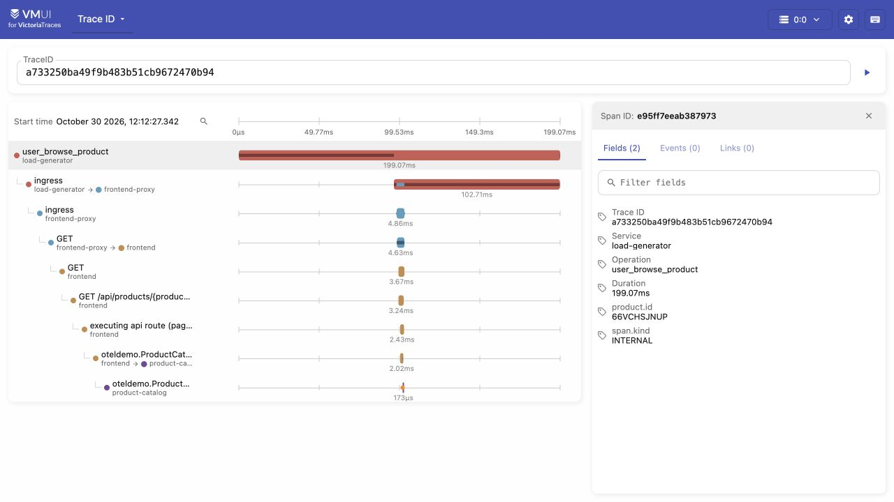
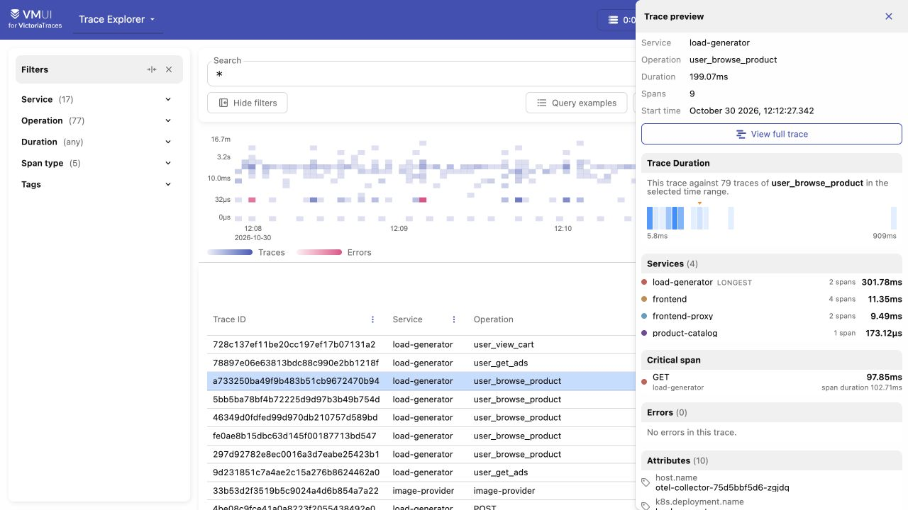
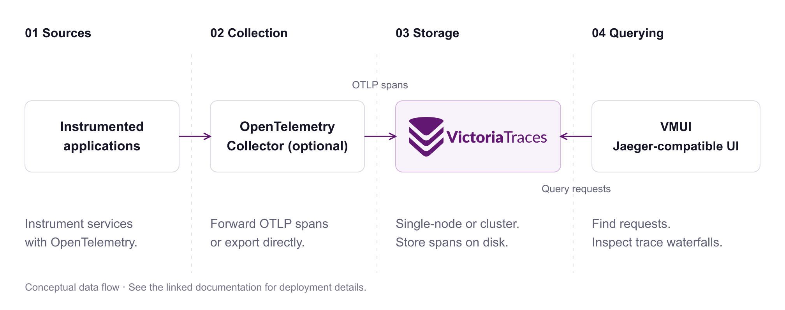

<p align="center">
  <picture><source media="(prefers-color-scheme: dark)" srcset="assets/logo-dark.svg"></picture>
</p>
<h1 align="center">Follow a request. Find where the time goes.</h1>
<p align="center">An open-source database for distributed traces.<br>Ingest OpenTelemetry spans, find requests, and inspect their waterfalls.</p>

<p align="center"><a href="#try-it-locally">Quick start</a> · <a href="https://play-vtraces.victoriametrics.com/select/vmui/">Live playground</a> · <a href="https://docs.victoriametrics.com/victoriatraces/">Documentation</a> · <a href="https://slack.victoriametrics.com/">Community</a></p>
<p align="center">
  <a href="https://github.com/VictoriaMetrics/VictoriaTraces/releases"></a>
  <a href="https://github.com/VictoriaMetrics/VictoriaTraces/actions/workflows/main.yml"></a>
  <a href="https://github.com/VictoriaMetrics/VictoriaTraces/blob/master/LICENSE"></a>
</p>

> **Work in progress.** On-disk formats and APIs may change without backward compatibility. Some links or static files may be unavailable. Check the [changelog](https://docs.victoriametrics.com/victoriatraces/changelog/) before upgrading.

<p align="center"><a href="https://play-vtraces.victoriametrics.com/select/vmui/"></a></p>
<p align="center"><sub>Follow parent and child spans across services, then inspect a span's fields, events, and links. <a href="https://play-vtraces.victoriametrics.com/select/vmui/">Explore live traces →</a></sub></p>

## Why VictoriaTraces?

- **Use your OpenTelemetry instrumentation.** Ingest spans over OTLP/HTTP or a separately enabled OTLP/gRPC listener. [Ingestion guide](https://docs.victoriametrics.com/victoriatraces/data-ingestion/opentelemetry/).
- **Find a request, then investigate it.** Use the built-in Trace Explorer and waterfall, or query span data with LogsQL. [Querying](https://docs.victoriametrics.com/victoriatraces/querying/).
- **Keep familiar query tools.** Connect Grafana's Jaeger data source or Jaeger UI through the supported Jaeger query APIs. [Supported APIs](https://docs.victoriametrics.com/victoriatraces/querying/).
- **Run without a separate storage service.** Store traces on disk with a single binary or an open-source cluster. [Storage](https://docs.victoriametrics.com/victoriatraces/#storage) · [Cluster](https://docs.victoriametrics.com/victoriatraces/cluster/).

## Try it locally

With Docker installed, start a single-node instance:

```sh
docker run --rm --name victoriatraces \
  -p 127.0.0.1:10428:10428 \
  -v victoriatraces-data:/victoria-traces-data \
  victoriametrics/victoria-traces:v0.12.1 \
  -storageDataPath=/victoria-traces-data
```

For an existing OpenTelemetry-instrumented application running on your host, set:

```sh
export OTEL_EXPORTER_OTLP_TRACES_PROTOCOL=http/protobuf
export OTEL_EXPORTER_OTLP_TRACES_ENDPOINT=http://localhost:10428/insert/opentelemetry/v1/traces
```

Restart the application with these settings and send it a request. Open [Trace Explorer](http://localhost:10428/select/vmui/); allow for the [default search delay](https://docs.victoriametrics.com/victoriatraces/querying/#search-latency). Applications in containers need a reachable host address instead of their own `localhost`.

No instrumented application yet? Follow the [sample-span and demo instructions](https://docs.victoriametrics.com/victoriatraces/quick-start/#write-data). Data persists in the named Docker volume.

## Find the request you need

<p align="center"><a href="assets/trace-explorer.jpg"></a></p>

Filter by service, operation, duration, or span attributes. Select a result to preview its services and duration, then open the full trace. [Explore the query interface](https://docs.victoriametrics.com/victoriatraces/querying/).

## How it works

<p align="center"><a href="assets/how-it-works.svg"></a></p>

VictoriaTraces uses the VictoriaLogs storage engine internally; **you do not need a separate VictoriaLogs instance**. In cluster mode, **vtinsert**, **vtstorage**, and **vtselect** separate ingestion, storage, and querying. [Architecture details](https://docs.victoriametrics.com/victoriatraces/cluster/).

## Deploy and operate

| Task | Documentation |
| --- | --- |
| Install | [Binaries](https://github.com/VictoriaMetrics/VictoriaTraces/releases/latest) · [Docker](https://hub.docker.com/r/victoriametrics/victoria-traces/) · [Quick start](https://docs.victoriametrics.com/victoriatraces/quick-start/) |
| Run on Kubernetes | [Single-node Helm chart](https://docs.victoriametrics.com/helm/victoria-traces-single/) · [Cluster Helm chart](https://docs.victoriametrics.com/helm/victoria-traces-cluster/) |
| Choose a topology | [Single-node](https://docs.victoriametrics.com/victoriatraces/) · [Cluster](https://docs.victoriametrics.com/victoriatraces/cluster/) |
| Manage data and access | [Retention](https://docs.victoriametrics.com/victoriatraces/#retention) · [Backup and restore](https://docs.victoriametrics.com/victoriatraces/#backup-and-restore) · [Security](https://docs.victoriametrics.com/victoriatraces/#security) |
| Monitor and upgrade | [Monitoring](https://docs.victoriametrics.com/victoriatraces/#monitoring) · [Changelog](https://docs.victoriametrics.com/victoriatraces/changelog/) |

Tenant headers identify partitions; use an authorization proxy to enforce access. For managed availability or commercial support, [contact the VictoriaMetrics team](mailto:info@victoriametrics.com) to confirm the scope you need.

## Community and contributions

[Join Slack](https://slack.victoriametrics.com/) · [Report an issue](https://github.com/VictoriaMetrics/VictoriaTraces/issues) · [Contribute](https://docs.victoriametrics.com/victoriametrics/contributing/) · [Apache 2.0 license](https://github.com/VictoriaMetrics/VictoriaTraces/blob/master/LICENSE)

Looking for another signal? [VictoriaMetrics — metrics](https://github.com/VictoriaMetrics/VictoriaMetrics) · [VictoriaLogs — logs](https://github.com/VictoriaMetrics/VictoriaLogs).
