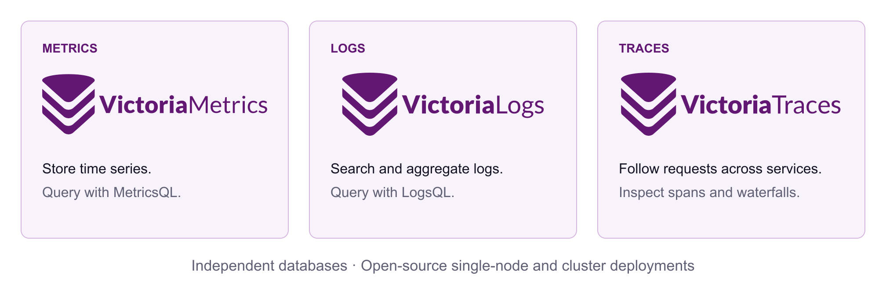

  <picture><source media="(prefers-color-scheme: dark)" srcset="assets/logo-dark.svg"></picture>

<h1 align="center">Open-source databases for metrics, logs, and traces.</h1>

Start with the signal you need. Collect with your existing tools, explore your data, and choose how you deploy.

<a href="https://docs.victoriametrics.com/">Documentation</a> · <a href="https://victoriametrics.com/">Website</a> · <a href="https://slack.victoriametrics.com/">Join the community</a> · <a href="https://docs.victoriametrics.com/victoriametrics/casestudies/">Customer stories</a>

## Choose your starting point

| Your task | Project | Explore |
| --- | --- | --- |
| Store Prometheus metrics and query time series | **[VictoriaMetrics](https://github.com/VictoriaMetrics/VictoriaMetrics)** | [Quick start](https://docs.victoriametrics.com/victoriametrics/quick-start/) · [Live demo](https://play.victoriametrics.com/) |
| Search messages and aggregate log data | **[VictoriaLogs](https://github.com/VictoriaMetrics/VictoriaLogs)** | [Quick start](https://docs.victoriametrics.com/victorialogs/quickstart/) · [Live demo](https://play-vmlogs.victoriametrics.com/) |
| Follow requests across services and inspect spans | **[VictoriaTraces](https://github.com/VictoriaMetrics/VictoriaTraces)** | [Quick start](https://docs.victoriametrics.com/victoriatraces/quick-start/) · [Live demo](https://play-vtraces.victoriametrics.com/select/vmui/) |

Each database has open-source single-node and cluster versions under Apache 2.0. They can be deployed independently. **VictoriaTraces is a work in progress:** review its [compatibility notice and release notes](https://github.com/VictoriaMetrics/VictoriaTraces) before adopting or upgrading it.

## Build around your existing tools

- **Collect:** use [vmagent](https://docs.victoriametrics.com/victoriametrics/vmagent/) and Prometheus for metrics, [supported log collectors](https://docs.victoriametrics.com/victorialogs/data-ingestion/) for logs, and [OpenTelemetry](https://docs.victoriametrics.com/victoriatraces/data-ingestion/opentelemetry/) for traces.
- **Explore:** use each product's built-in UI, or connect Grafana through the [metrics integration](https://docs.victoriametrics.com/victoriametrics/integrations/grafana/), [VictoriaLogs data source](https://docs.victoriametrics.com/victorialogs/victorialogs-datasource/), and [Jaeger-compatible trace integration](https://docs.victoriametrics.com/victoriatraces/querying/).
- **Operate:** use the [VictoriaMetrics Operator](https://github.com/VictoriaMetrics/operator), [Helm charts](https://github.com/VictoriaMetrics/helm-charts), [vmauth](https://docs.victoriametrics.com/victoriametrics/vmauth/), and [vmalert](https://docs.victoriametrics.com/victoriametrics/vmalert/).

## Choose how you run it

| Option | What it offers | Next step |
| --- | --- | --- |
| **Open source** | Self-managed single-node and cluster deployments, with community support | [Browse documentation](https://docs.victoriametrics.com/) |
| **Enterprise** | Commercial support and additional capabilities; features and LTS coverage vary by product | [Metrics Enterprise](https://docs.victoriametrics.com/victoriametrics/enterprise/) · [Confirm product coverage](mailto:info@victoriametrics.com) |
| **Cloud** | Managed deployments in VictoriaMetrics Cloud | [Explore Cloud](https://victoriametrics.com/products/cloud/) |

For support or deployment guidance, [contact the team](mailto:info@victoriametrics.com).

## See how teams use VictoriaMetrics

Read the [Grammarly, Roblox, Wix, Spotify, and other customer stories](https://docs.victoriametrics.com/victoriametrics/casestudies/) for workload-specific examples. Results depend on the system and workload; the stories provide context for your own evaluation.

## Join the community

[Ask questions on Slack](https://slack.victoriametrics.com/) · [Contribute](https://docs.victoriametrics.com/victoriametrics/contributing/) · [Read the blog](https://victoriametrics.com/blog/) · [Watch technical videos](https://www.youtube.com/@VictoriaMetrics) · [Explore careers](https://careers.victoriametrics.com/)

Report bugs in the relevant product repository. For vulnerability reporting and security information, see our [security page](https://victoriametrics.com/security/).
